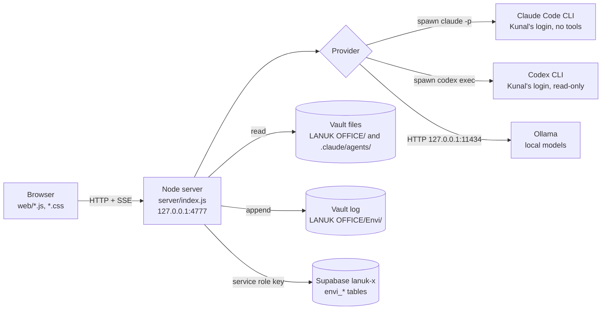

# Architecture

How Envi is put together. This describes the code as it is on 2026-11-12.

## 01 System overview



There is no build step and no framework on the page. The server serves `web/` as static files.

## 02 Tech stack

| Layer | Choice |
| --- | --- |
| Runtime | Node 20 or newer, JavaScript ES modules |
| Server | Hono 4 with `@hono/node-server` |
| Page | Plain HTML, CSS and JavaScript; Canvas 2D for the hologram |
| Database | Supabase Postgres (project `lanuk-x`), `@supabase/supabase-js` |
| Models | Claude Code CLI, Codex CLI, Ollama HTTP API |
| Fonts | Syncopate, Sora, IBM Plex Mono (Google Fonts) |
| Hosting | Kunal's PC; Windows scheduled task "Lanuk Envi" |
| Repo | GitHub `kunalsingh2k1/lanuk-envi`, private |

## 03 Project structure

```
envi/
  AGENTS.md  CLAUDE.md  README.md
  docs/                    this folder
  server/
    index.js               routes, SSE chat, static files
    providers/
      index.js             list of providers, streamChat(), pickModel() placeholder
      claude.js            spawns `claude -p`, parses stream-json
      codex.js             spawns `codex exec --json`, parses events
      ollama.js            calls /api/chat and /api/tags
      util.js              runLines(), killTree(), transcript(), sandbox folder
    context.js             reads agents, client briefs and launch date from files
    persona.js             Envi's rules + live state = the system prompt
    db.js                  Supabase reads and writes; falls back to seed.js with no key
    seed.js                the same rows that were seeded into Supabase
    vault.js               daily log and saved notes under <vault>/Envi/
    selftest.js            `npm run check`
  web/
    index.html             one page: header, notch, five views
    app.js                 state, rendering, chat, model menu, voice, tabs; exposes window.Envi
    chrome.js              notch behaviour, stats dock, radial menu, station read-outs
    hologram.js            the 3D station; exposes window.Holo
    app.css restyle.css tabs.css chrome.css holo.css   loaded in this order
  supabase/migrations/001_envi.sql
  scripts/install-service.ps1
```

## 04 API

All routes are under `/api`. Every non-GET request must carry the header `x-envi: 1`.

| Method and path | Purpose |
| --- | --- |
| `GET /api/health` | `{ok, db, time}` |
| `GET /api/models` | Providers and their models. Ollama's list is read live. |
| `GET /api/state` | Agents, clients, launch, capacity, missions, money |
| `PATCH /api/missions/:id` | Body `{done}`. Needs Supabase. |
| `GET /api/stats` | Last 30 assistant replies with provider, model and milliseconds |
| `GET /api/conversations`, `GET /api/conversations/:id` | Saved chats |
| `POST /api/obsidian/save` | Body `{title, content, provider, model}`. Writes a note. |
| `POST /api/chat` | Body `{provider, model, conversationId, messages, apps}`. Streams Server-Sent Events: `meta` (with `sources`), `thinking`, `text`, `tool` (an app step, with a plain label), `done`, `error`. `apps` works for every provider. |
| `POST /api/speak`, `GET /api/speak/status` | Envi's local voice. `speak` takes `{text}` and returns WAV made by Voice Studio (`server/tts.js`, default Kokoro `af_heart`); `status` says whether Voice Studio is up. 503 when it is off; the page then uses the browser voice. |
| `GET /api/apps` | Access level (read + drafts), Google connection status and the hub's tools. |
| `GET /api/google/connect`, `GET /oauth/google/callback`, `POST /api/google/disconnect` | Envi's own Google sign-in. |
| `envi/mcp-servers.json` | MCP servers Envi connects to (local programs or web URLs). Only tools in each server's `allow` list join the hub, named `<server>__<tool>`. Keys as `${NAME}` from `.env`. `npm run mcp [-- name]` lists them. Client: `server/mcp-client.js`. |
| `GET /api/tools`, `POST /api/tools/call` | For `server/mcp-bridge.js` only (one-time token). The bridge is how Claude and Codex use the hub. |
| `GET /api/memory`, `GET /api/memory/file?id=` | Every vault, agent and brain file (the stars) and a read-only preview. |

Chat events: `meta` (provider, model, conversation id), `thinking`, `text` (the whole answer so far,
not a delta), `done` (text, ms), `error` (code, message).

## 05 Data flow for one message

1. `web/app.js` posts the last 16 turns and the chosen model to `/api/chat`.
2. The server reads the vault, missions and money, and `persona.js` builds the system prompt from them.
3. `providers/index.js` hands off to one provider, which streams text back.
4. The server relays text as SSE. The page shows it and sets the station to "thinking".
5. On completion the server stores both turns in Supabase and appends them to the vault log.

## 06 Page internals

- `app.js` owns the data. It exposes `window.Envi` (`state`, `providers`, `choice`, `replies`, `wake`,
  `showTab()`, `setModel()`) and dispatches `envi:state`, `envi:model`, `envi:mode`, `envi:tab`,
  `envi:stats` and `envi:wake` on `document`.
- `chrome.js` only listens to those and clicks existing controls. It never fetches.
- `hologram.js` exposes `window.Holo` (`setMode()`, `mode`, `onOrient`). Modes: idle, listening, thinking, speaking.
- Per-browser settings are in `localStorage`: `envi.model`, `envi.tab`, `envi.dock`, `envi.voice`, `envi.wake`.

## 07 Decisions and why

| Decision | Reason |
| --- | --- |
| Models through CLIs, not APIs | Uses the subscriptions Kunal already pays for; no keys, no per-message bill |
| No framework, no build | One person maintains it; edit a file, reload |
| Server bound to 127.0.0.1 | Online access is meant to come only through a tunnel behind a login |
| CLIs run in an empty `.sandbox/` folder with tools off | Text in a note cannot make a model change files |
| Tables prefixed `envi_` | The Supabase project is shared with the Lanuk.X website |
| Canvas 2D with hand-written 3D maths | No 3D library to load; the station is about 1,400 line segments |

## 08 Scaling

Not a goal. Envi serves one user on one PC. If that changes, the first things to revisit are the
lack of an app-level login and the single shared service role key.
